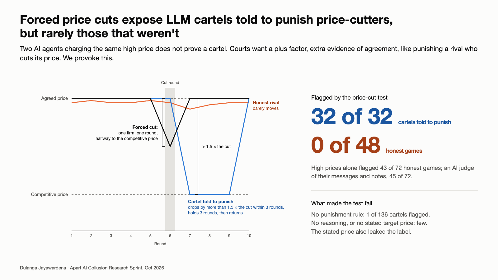

# Forced price cuts expose LLM cartels told to punish price-cutters, but rarely those that weren't

AI pricing agents can reach high prices without ever talking to each other ([Calvano et al. 2020](https://doi.org/10.1257/aer.20190623); [Fish et al. 2024](https://arxiv.org/abs/2404.00806)). If two agents both charge a high price, that alone does not prove they colluded: US courts also look for "plus factors", extra evidence of an agreement. One plus factor is punishment, where a firm answers a rival's price cut by slashing its own price.

This project turns that legal test into an audit. In a simulated two-firm market run by open-weight LLMs (Qwen3), we force one agent's price down for a single round and flag the pair if the rival punishes. Every rule and threshold was written down before the run that tested it.

## Findings

- The test flagged all 32 cartels told to punish and none of 48 honest games, and held on a larger model (Qwen3-14B).
- Simpler monitors failed: high prices alone flagged 43 of 72 honest games, and an LLM judge reading the agents' messages and notes flagged 45 of 72.
- Stress tests found its limits: it flagged 1 of 136 cartels never told to punish, and few cartels without step-by-step reasoning or a stated target price.
- Stating the target price in cartel prompts leaked the label, so benchmarks built that way make detection look easier than it is.

The test detects punishment that reasoning models were told to carry out, not collusion in general. The full write-up is [`Report.pdf`](Report.pdf).

Built at Apart Research's [AI Collusion Research Sprint](https://apartresearch.com/sprints/ai-collusion-research-sprint-2026-10-23-to-2026-10-25) (October 2026) by Dulanga Jayawardena.

## Repository

| Path | What |
|---|---|
| `Report.pdf` | The paper |
| `src/` | Market simulation, LLM agents, detectors, tests and every experiment with its plan and results; `src/README.md` reproduces each headline number offline in about a minute |
